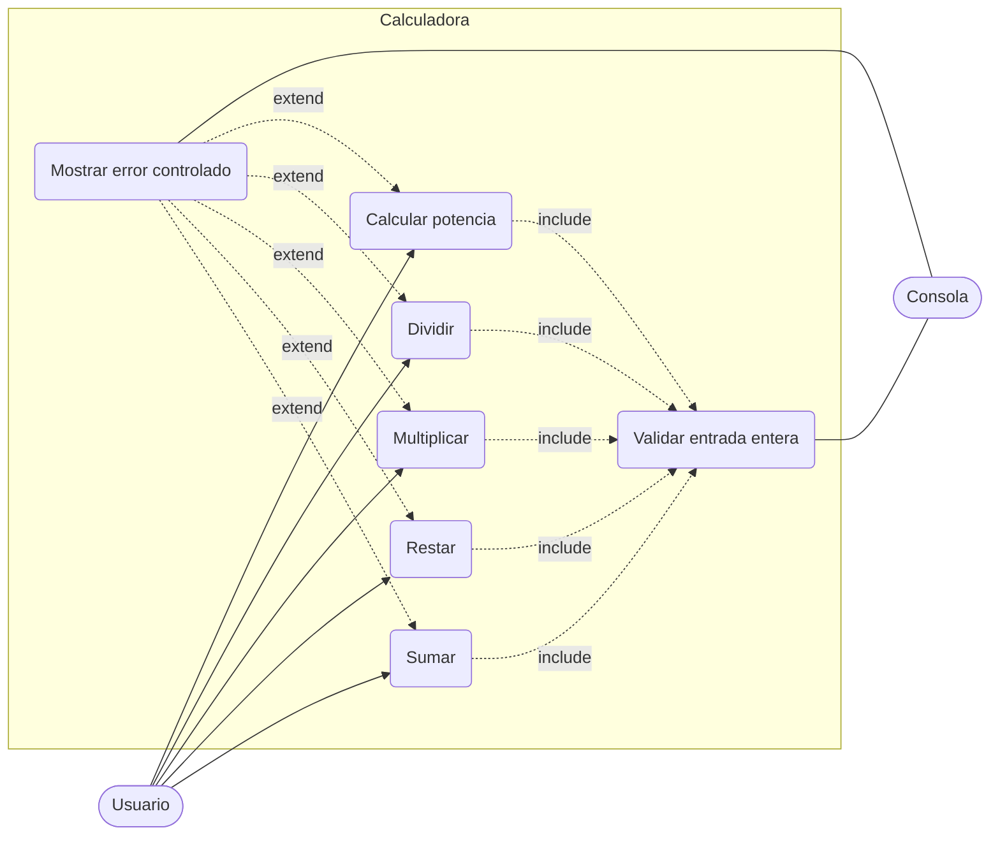

# Análisis ISO/IEC 25010 y especificación de casos de uso (UML)

Contexto: aplicación de consola en Java, un solo proceso, sin red, sin base de datos, sin autenticación y sin datos persistentes. Recibe dos enteros y calcula suma, resta, multiplicación, división y potencia.

Este documento es el resumen centrado en la consola, que es la interfaz que pide el enunciado. La ventana Swing opcional (`--gui`) y el detalle completo están en `docs/01_UML_Y_ACTORES.md` y `docs/03_CALIDAD_ISO_25010.md`.

## 1. Calidad según ISO/IEC 25010

### 1.1 Dimensiones que aplican

| Característica | Por qué aplica | Pruebas asociadas |
|---|---|---|
| **Adecuación funcional** (corrección y completitud) | El valor del producto es que las cinco operaciones existan y den el resultado correcto. | `CalculadoraTest`: `sumar`, `restar`, `multiplicar`, `dividir`, `potencia` (valores normales, cero, negativos, `0^0`, `2^30`). `InterfazConsolaTest`: cada opción del menú muestra su resultado. |
| **Fiabilidad** (tolerancia a fallos) | Los riesgos reales son la división por cero, el desbordamiento de `int`, el exponente negativo y el texto en lugar de un número. El programa no debe terminar por una excepción sin controlar. | `CalculadoraTest`: `dividirPorCero`, `potenciaConExponenteNegativo`, `desbordamiento`. `InterfazConsolaTest`: los casos que esperan `Error: ...` y `Entrada inválida: ...`. |
| **Usabilidad** (protección contra errores del usuario) | Toda la interacción es por consola; un mensaje confuso es el principal defecto posible. Cada error dice qué pasó y el menú vuelve a mostrarse. | `InterfazConsolaTest`: mensajes de división por cero, exponente negativo, entrada no entera y opción inválida. Pendiente: prueba con usuarios (tareas completadas sin ayuda). |
| **Mantenibilidad** (modularidad, modificabilidad, capacidad de prueba) | El proyecto ya recibió un cambio de alcance (potencia): interesa qué tan barato es cambiar. Cada operación es un método independiente y el menú sale de la enumeración `Operacion`. | El commit de la potencia tocó `Calculadora`, `Operacion` y `Resultado`; `InterfazConsola` no cambió. Las 39 pruebas sirven de regresión. Pendiente: cobertura (JaCoCo) y análisis estático. |

### 1.2 Dimensiones que no aplican

| Característica | Justificación |
|---|---|
| **Seguridad** | No hay red, usuarios, sesiones, secretos ni datos persistentes. Lo único relevante, validar las entradas, ya se cubre en Fiabilidad. |
| **Compatibilidad** | No intercambia información con otros sistemas ni comparte recursos. |
| **Portabilidad** | Corre en cualquier JVM 17 o superior; basta compilar con `--release 17`. No justifica un plan de pruebas por sistema operativo. |
| **Eficiencia de desempeño** | Cada operación es O(1), salvo `potencia`, que es O(b) y se detiene al desbordar (como máximo 31 iteraciones si el valor absoluto de la base es 2 o más). No justifica pruebas de carga. |

### 1.3 Estado actual

- Adecuación funcional y fiabilidad: 39 de 39 pruebas JUnit pasan.
- Usabilidad con usuarios, cobertura y análisis estático: definidos, no ejecutados.

## 2. Casos de uso (UML)

### 2.1 Actores

| Actor | Tipo | Rol |
|---|---|---|
| **Usuario** | Principal (humano) | Elige la operación en el menú, ingresa los enteros `a` y `b` y lee el resultado o el mensaje de error. |
| **Consola** | Secundario (sistema) | Entrada estándar (`Scanner` sobre `System.in`) y salida estándar (`System.out`). |
| **Cliente** | Interesado (no usa el sistema) | Aprueba los requisitos y los cambios de alcance, como la potencia. |

### 2.2 Casos de uso

| ID | Caso de uso | Actor | Flujo principal | Flujos alternos |
|---|---|---|---|---|
| CU-01 | Sumar | Usuario | Elige la opción 1, ingresa `a` y `b`, ve `a + b`. | Desbordamiento de `int`: CU-06. |
| CU-02 | Restar | Usuario | Elige la opción 2, ingresa `a` y `b`, ve `a - b`. | Desbordamiento de `int`: CU-06. |
| CU-03 | Multiplicar | Usuario | Elige la opción 3, ingresa `a` y `b`, ve `a * b`. | Desbordamiento de `int`: CU-06. |
| CU-04 | Dividir | Usuario | Elige la opción 4, ingresa `a` y `b`, ve la división entera `a / b`. | `b = 0`: CU-06 con "no se puede dividir entre cero". |
| CU-05 | Calcular potencia | Usuario | Elige la opción 5, ingresa `a` y `b`, ve `a ^ b`. | `b < 0` o desbordamiento: CU-06. |
| CU-06 | Mostrar error controlado | Consola | Muestra un mensaje claro y vuelve al menú sin cerrar el programa. | |
| CU-07 | Validar entrada entera | Consola | Si el dato no es un entero, muestra "Entrada inválida" y lo vuelve a pedir. | |

Relaciones: CU-01 a CU-05 incluyen CU-07; CU-06 extiende a CU-01 a CU-05.

### 2.3 Diagrama

