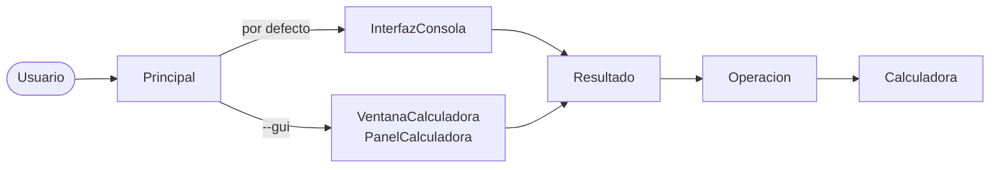
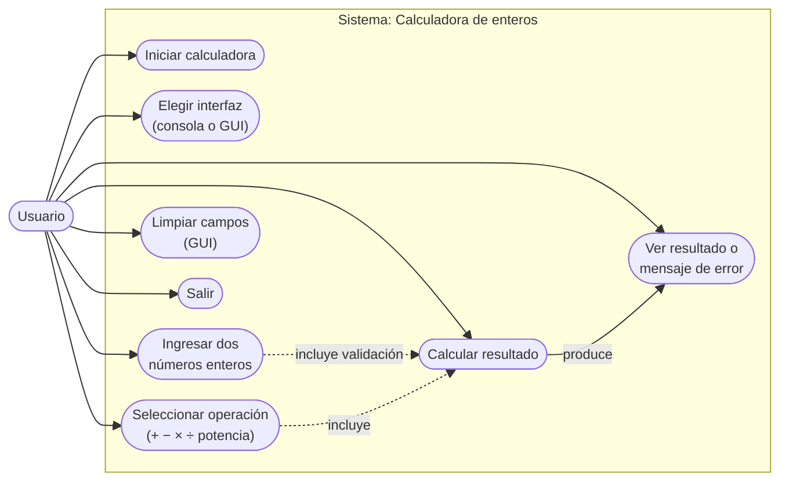
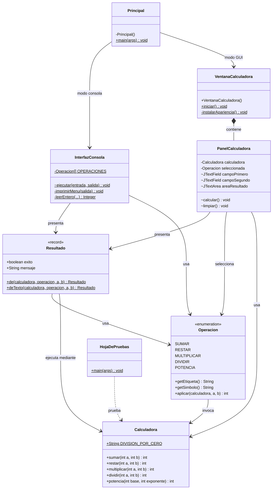
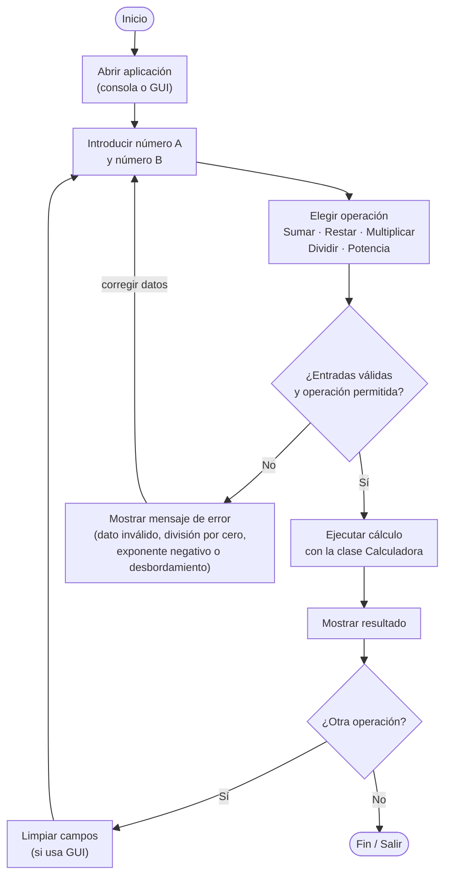

<div align="center">

# Calculadora de enteros en Java

### Trabajo de Calidad de Software

Aplicación de consola con pruebas unitarias, análisis de calidad **ISO/IEC 25010**<br>
y gestión formal de cambios.

<br>


<br>

[Descripción](#descripción) •
[Características](#características) •
[Inicio rápido](#inicio-rápido) •
[Demostración](#demostración) •
[Arquitectura](#arquitectura) •
[Diagramas](#diagramas-uml) •
[Pruebas](#pruebas) •
[Calidad](#calidad-isoiec-25010) •
[Documentación](#documentación)

</div>

---

## Descripción

Calculadora que recibe **dos números enteros por consola** y ejecuta cinco operaciones aritméticas: suma, resta, multiplicación, división y potencia. Toda la lectura y escritura se realiza con `Scanner` y `System.out`.

El proyecto recorre el ciclo completo que exige la asignatura:

| Etapa | Entregable |
|---|---|
| **Implementación** | Cinco operaciones en métodos independientes, con validación de datos. |
| **Pruebas** | 39 pruebas unitarias con JUnit 5 y una hoja de pruebas de 41 casos. |
| **Modelado** | Actores, casos de uso, diagrama de clases y de secuencia en UML. |
| **Calidad** | Evaluación según las características de la norma ISO/IEC 25010. |
| **Gestión de cambios** | Solicitud de cambio **CR-001**: incorporación de la operación de potencia. |

## Características

| Característica | Detalle |
|---|---|
| **Cinco operaciones** | `sumar`, `restar`, `multiplicar`, `dividir` y `potencia`, cada una en su propio método. |
| **Solo números enteros** | Ante un dato inválido se informa el error y se vuelve a solicitar. |
| **División por cero controlada** | Muestra un mensaje claro y el programa continúa en ejecución. |
| **Potencia con ciclo `for`** | Implementada sin `Math.pow`, con control de exponente negativo. |
| **Detección de desbordamiento** | Si el resultado no cabe en un `int`, se informa un error en lugar de un valor incorrecto. |
| **Interfaz gráfica opcional** | Ventana Swing con `--gui`, que comparte la lógica y los mensajes de la consola. |

## Inicio rápido

> [!IMPORTANT]
> Se necesita **JDK 17 o superior**. No hace falta instalar Maven: IntelliJ IDEA y Visual Studio Code ya lo incluyen.

<table>
<tr>
<th width="50%">IntelliJ IDEA</th>
<th width="50%">Visual Studio Code</th>
</tr>
<tr>
<td valign="top">

1. <kbd>File</kbd> › <kbd>Open</kbd> y elegir la carpeta del proyecto.
2. Abrir `Principal.java`.
3. Pulsar el botón de ejecutar junto al método `main`.

</td>
<td valign="top">

1. Instalar el *Extension Pack for Java*.
2. <kbd>File</kbd> › <kbd>Open Folder</kbd>.
3. En *Run and Debug*, elegir `Calculadora (consola)`.

</td>
</tr>
</table>

<details>
<summary><b>Con Maven desde la terminal</b></summary>

<br>

```bash
mvn test       # ejecuta las pruebas JUnit
mvn package    # genera target/calculadora-1.1.0.jar
java -jar target/calculadora-1.1.0.jar
```

</details>

<details>
<summary><b>Sin Maven, con PowerShell</b></summary>

<br>

Desde la raíz del proyecto:

```powershell
javac --release 17 -encoding UTF-8 -d build\classes (Get-ChildItem -Recurse src\main -Filter *.java).FullName
java -cp build\classes com.calculadora.Principal          # consola
java -cp build\classes com.calculadora.Principal --gui    # ventana
```

</details>

## Demostración

```text
Calculadora de números enteros 

1. Sumar
2. Restar
3. Multiplicar
4. Dividir
5. Potencia
0. Salir
Seleccione una opción: 5
Ingrese el primer número (a): 2
Ingrese el segundo número (b): 10
Resultado: 2 ^ 10 = 1024
```

Errores controlados:

| Situación | Entrada | Respuesta del programa |
|---|---|---|
| División por cero | `10 / 0` | `Error: no se puede dividir entre cero.` |
| Dato no entero | `abc` | `Entrada inválida: ingrese un número entero.` |
| Exponente negativo | `2 ^ -1` | `Error: el exponente no puede ser negativo (el resultado no es un entero).` |
| Resultado fuera de rango | `2 ^ 31` | `Error: el resultado excede el rango de los enteros (int).` |

## Arquitectura

La consola y la ventana no contienen lógica de cálculo: ambas delegan en `Resultado`, que ejecuta la operación y convierte cualquier error en un mensaje para el usuario.



| Clase | Responsabilidad |
|---|---|
| `Principal` | Punto de entrada; elige entre consola y ventana. |
| `InterfazConsola` | Menú, lectura de datos con `Scanner` y validación de enteros. |
| `VentanaCalculadora` · `PanelCalculadora` | Interfaz gráfica Swing opcional. |
| `Resultado` | Ejecuta la operación y redacta el mensaje de resultado o de error. |
| `Operacion` | Enumeración de las operaciones del menú, con su símbolo. |
| `Calculadora` | Las cinco operaciones aritméticas, sin estado. |

<details>
<summary><b>Estructura de carpetas</b></summary>

<br>

```text
├── pom.xml                                    Proyecto Maven (IntelliJ IDEA y VS Code)
├── build.sh                                   Script de construcción para bash
├── README.md
├── ANALISIS_ISO25010_Y_UML.md                 Resumen de calidad ISO 25010 y casos de uso
├── .vscode/                                   Configuraciones de ejecución para VS Code
├── src/
│   ├── main/java/com/calculadora/
│   │   ├── Principal.java                     Punto de entrada: consola (por defecto) o --gui
│   │   ├── Calculadora.java                   Las cinco operaciones aritméticas
│   │   ├── Operacion.java                     Enumeración de operaciones del menú
│   │   ├── Resultado.java                     Mensajes de resultado y de error
│   │   ├── InterfazConsola.java               Menú de consola (Scanner)
│   │   ├── VentanaCalculadora.java            Ventana de la interfaz gráfica
│   │   └── PanelCalculadora.java              Contenido de la interfaz gráfica
│   ├── test/java/com/calculadora/
│   │   ├── CalculadoraTest.java               Pruebas JUnit de las operaciones
│   │   └── InterfazConsolaTest.java           Pruebas JUnit de la consola
│   └── hoja-pruebas/java/com/calculadora/
│       ├── HojaDePruebas.java                 Ejecutor de los 41 casos de la hoja de pruebas
│       └── DiagnosticoFallos.java             Diagnóstico automático de fallos
└── docs/                                      Documentación del trabajo
```

</details>

## Diagramas UML

Los mismos diagramas del documento [UML CASOS DE USO.docx](docs/UML%20CASOS%20DE%20USO.docx), con los nombres del código en español.

### Diagrama de casos de uso



### Diagrama de clases



### Diagrama de flujo del usuario



## Pruebas

| Conjunto | Ubicación | Casos | Alcance |
|---|---|:-:|---|
| **Pruebas unitarias JUnit 5** | `src/test` | 39 | Las cinco operaciones con sus casos límite y la consola con entrada simulada. |
| **Hoja de pruebas ejecutable** | `src/hoja-pruebas` | 41 | Los casos de la hoja de Excel: 31 unitarios, 5 de consola y 5 de interfaz gráfica. |

Casos límite cubiertos: división por cero, `0 ^ 0`, exponente cero y negativo, base negativa, desbordamiento de `int` y entradas no numéricas.

> [!TIP]
> Desde el IDE basta con ejecutar las clases de `src/test`. Con Maven, `mvn test`.

<details>
<summary><b>Ejecutar JUnit sin Maven (PowerShell)</b></summary>

<br>

```powershell
# Una sola vez: descargar JUnit 5
Invoke-WebRequest "https://repo1.maven.org/maven2/org/junit/platform/junit-platform-console-standalone/1.11.4/junit-platform-console-standalone-1.11.4.jar" -OutFile junit.jar

javac --release 17 -encoding UTF-8 -cp "build\classes;junit.jar" -d build\test-classes (Get-ChildItem -Recurse src\test -Filter *.java).FullName
java "-Dfile.encoding=UTF-8" -jar junit.jar execute -cp "build\classes;build\test-classes" --scan-classpath build\test-classes --details=tree
```

</details>

<details>
<summary><b>Ejecutar la hoja de pruebas (PowerShell)</b></summary>

<br>

`HojaDePruebas` no requiere JUnit. Ejecuta los 41 casos y actualiza `docs/resultados_pruebas.md` y `docs/diagnostico_fallos.md`:

```powershell
javac --release 17 -encoding UTF-8 -cp build\classes -d build\hoja-classes (Get-ChildItem -Recurse src\hoja-pruebas -Filter *.java).FullName
java "-Dfile.encoding=UTF-8" "-Dstdout.encoding=UTF-8" -cp "build\classes;build\hoja-classes" com.calculadora.HojaDePruebas docs
```

</details>

<details>
<summary><b>Script de construcción para bash</b></summary>

<br>

| Comando | Acción |
|---|---|
| `./build.sh` | Compila, ejecuta la hoja de pruebas y genera `build/calculadora-1.1.0.jar`. |
| `./build.sh probar` | Compila y ejecuta únicamente la hoja de pruebas. |
| `./build.sh ejecutar` | Abre la consola. |
| `./build.sh gui` | Abre la interfaz gráfica. |
| `./build.sh dependencias` | Descarga la apariencia FlatLaf (opcional) en `lib/`. |
| `./build.sh distribucion` | Genera además `dist/calculadora-v1.1.0.zip`. |
| `./build.sh limpiar` | Elimina `build/` y `dist/`. |

> **Nota:** `build.sh` no pudo ejecutarse en el equipo donde se preparó el proyecto (Windows sin bash). Los comandos de PowerShell y de Maven de este documento sí fueron ejecutados.

</details>

### Diagnóstico automático de fallos

Cuando un caso de la hoja de pruebas falla, el informe indica tres cosas:

| | Sección | Contenido |
|:-:|---|---|
| 1 | **Ubicación exacta** | Archivo, clase, método y línea, o el componente de la interfaz gráfica. |
| 2 | **Causa raíz** | Explicación técnica del defecto. |
| 3 | **Corrección sugerida** | El fragmento de código corregido. |

La demostración con seis defectos introducidos a propósito está en [05. Diagnóstico de fallos](docs/05_DIAGNOSTICO_DE_FALLOS.md).

## Calidad ISO/IEC 25010

| Característica | ¿Se evalúa? | Motivo |
|---|:-:|---|
| **Adecuación funcional** | Sí | El valor del producto es que las cinco operaciones den el resultado correcto. |
| **Fiabilidad** | Sí | División por cero, desbordamiento y datos inválidos no deben detener el programa. |
| **Usabilidad** | Sí | Toda la interacción es por consola: los mensajes deben ser claros. |
| **Mantenibilidad** | Sí | El proyecto ya recibió un cambio de alcance (la potencia). |
| **Seguridad** | No | No hay red, usuarios ni datos persistentes. |
| **Compatibilidad** | No | No intercambia información con otros sistemas. |
| **Portabilidad** | No | Corre en cualquier JVM 17 o superior. |
| **Eficiencia de desempeño** | No | Cálculos triviales; no justifica pruebas de carga. |

El análisis completo, con métricas y pruebas asociadas, está en [03. Calidad ISO/IEC 25010](docs/03_CALIDAD_ISO_25010.md).

## Documentación

| Documento | Contenido |
|---|---|
| [Análisis ISO 25010 y casos de uso](ANALISIS_ISO25010_Y_UML.md) | Resumen de las dimensiones de calidad y especificación de los casos de uso. |
| [01. UML y actores](docs/01_UML_Y_ACTORES.md) | Actores, casos de uso, diagrama de clases y diagrama de secuencia. |
| [Diagrama UML de casos de uso](docs/UML%20CASOS%20DE%20USO.docx) | Diagrama de casos de uso en formato Word. |
| [02. Plan de pruebas](docs/02_PLAN_DE_PRUEBAS.md) | Convenciones y tabla de los 41 casos con sus resultados. |
| [Hoja de pruebas unitarias](docs/pruebas_unitarias.xlsx) | Hoja de Excel con el resultado esperado, el obtenido y el estado de cada caso. |
| [03. Calidad ISO/IEC 25010](docs/03_CALIDAD_ISO_25010.md) | Características evaluadas, métricas y justificación de las descartadas. |
| [04. Gestión de cambios](docs/04_GESTION_DE_CAMBIOS.md) | Comunicado formal al cliente sobre la solicitud de cambio CR-001. |
| [05. Diagnóstico de fallos](docs/05_DIAGNOSTICO_DE_FALLOS.md) | Funcionamiento del módulo de diagnóstico y demostración con seis defectos. |
| [Resultados de la última ejecución](docs/resultados_pruebas.md) | Tabla generada por `HojaDePruebas`. |

## Decisiones de diseño

| Tema | Decisión |
|---|---|
| **Idioma del código** | Paquete, clases, métodos, variables y comentarios en español. Los identificadores no llevan tildes ni ñ (`Operacion`, `DIVISION_POR_CERO`) para evitar problemas de codificación. Se conservan en inglés los nombres propios de Java y sus bibliotecas (`main`, `ArithmeticException`, Swing, JUnit). |
| **Consola por defecto** | El enunciado exige entrada y salida por consola: sin argumentos se inicia la consola; la ventana solo se abre con `--gui`. |
| **División por cero** | `dividir` lanza `ArithmeticException` y `Resultado` la convierte en un mensaje claro. El programa no se interrumpe. |
| **División entera** | Trunca hacia cero: `7 / 2 = 3` y `-7 / 2 = -3`. |
| **Desbordamiento** | Se emplean `Math.addExact`, `subtractExact` y `multiplyExact` para detectar resultados fuera del rango de `int`. |
| **Potencia (CR-001)** | Ciclo `for` sin `Math.pow`. Por convención, `x^0 = 1`, incluido `0^0 = 1`. El exponente negativo no se admite porque el resultado no es entero. |
| **Lógica compartida** | La consola y la ventana usan la misma enumeración `Operacion` y los mismos mensajes de `Resultado`, sin duplicar código. |
| **Apariencia FlatLaf** | Opcional y cargada en tiempo de ejecución; sin su `.jar` la ventana usa la apariencia Nimbus. |

---

<div align="center">

### Autor

**Santiago Rosero**

Estudiante de cuarto semestre de Ingeniería de Software

[](https://github.com/ssantivr)

</div>
