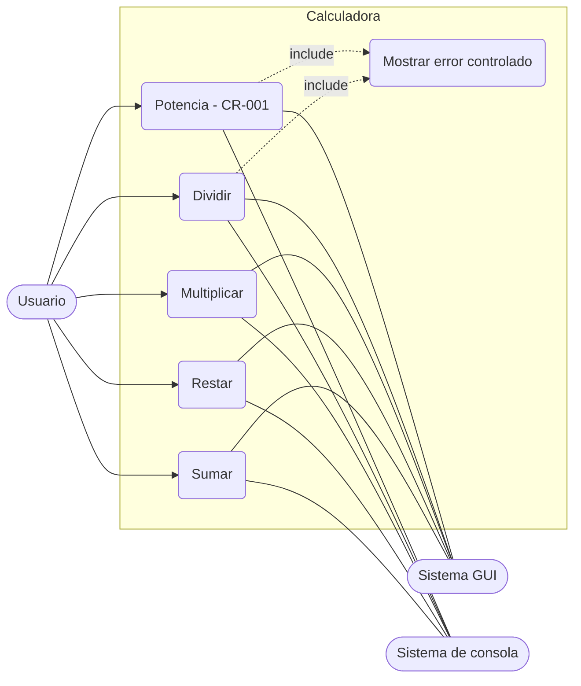
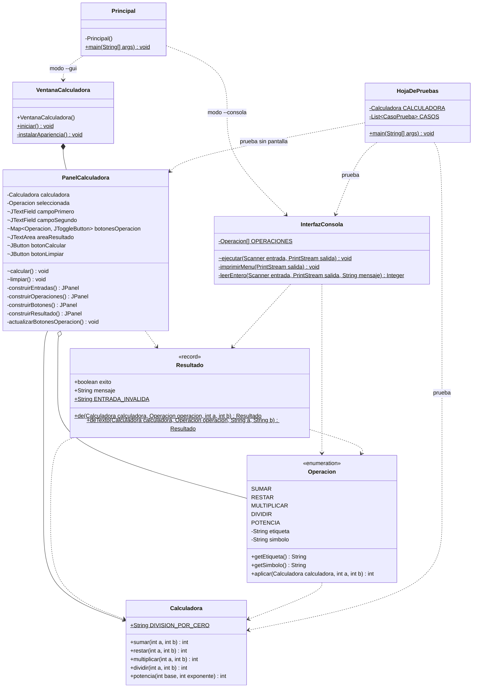
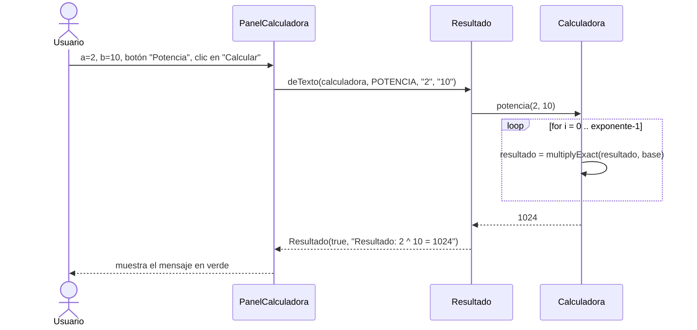

# 1. Diagrama UML y actores

## 1.1 Actores

| Actor | Tipo | Rol |
|---|---|---|
| **Usuario** | Principal (humano) | Ingresa dos enteros `a` y `b`, elige la operación y lee el resultado o el mensaje de error, ya sea en la ventana (GUI) o en la consola. |
| **Sistema GUI (Swing)** | Secundario (sistema) | Ventana con campos, selector de operaciones y área de resultado (`VentanaCalculadora` / `PanelCalculadora`). Usa FlatLaf si está disponible. |
| **Sistema de consola** | Secundario (sistema) | Entrada estándar (`Scanner` sobre `System.in`) y salida estándar (`System.out`). |
| **Cliente / Patrocinador** | Interesado (no usa el sistema) | Aprueba los requisitos y los cambios de alcance (ver `04_GESTION_DE_CAMBIOS.md`). |

## 1.2 Casos de uso

## 1.3 Diagrama de clases

`+` público · `-` privado · `~` visible en el paquete · `$` estático. `Calculadora` no tiene atributos de instancia (es **sin estado**).

`Operacion` y `Resultado` evitan duplicar lógica: la consola y la GUI usan la misma enumeración de operaciones y los mismos mensajes (en español).

## 1.4 Secuencia: potencia desde la GUI

